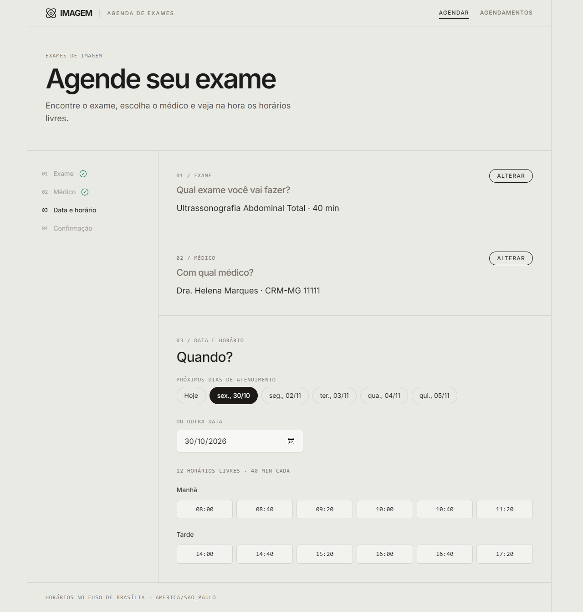
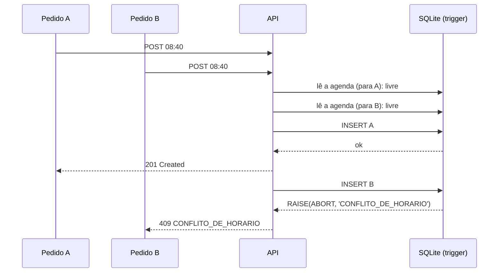
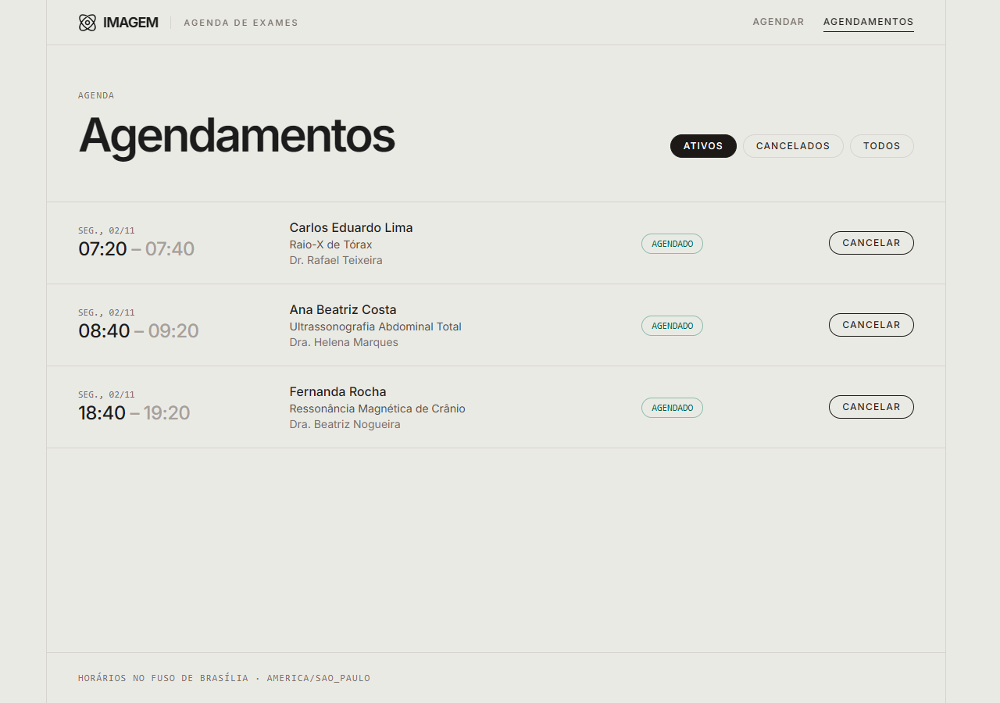

# Agendamento de Exames de Imagem

[](https://github.com/cesariolins/agendamentoExameImagem/actions/workflows/ci.yml)

Aplicação full stack para marcar exames de imagem. O paciente busca o exame, escolhe o médico, vê os horários livres de uma data e agenda. O back-end é uma API REST em **NestJS** e o front-end é uma SPA em **React**.



## Sumário

- [Como rodar](#como-rodar)
- [Como rodar os testes](#como-rodar-os-testes)
- [Arquitetura e decisões](#arquitetura-e-decisões)
- [Premissas](#premissas)
- [API e exemplos de requisição](#api-e-exemplos-de-requisição)
- [O que ficou de fora e próximos passos](#o-que-ficou-de-fora-e-próximos-passos)

## Como rodar

**Pré-requisito:** Node.js **22.12 ou superior** (o `.nvmrc` aponta para a 24). Não é preciso instalar banco de dados nem Docker: a persistência é um arquivo SQLite criado pelo próprio projeto.

```bash
git clone https://github.com/cesariolins/agendamentoExameImagem.git
cd agendamentoExameImagem
npm install
npm run db:setup
npm run dev
```

| Comando            | O que faz                                                                         |
| ------------------ | --------------------------------------------------------------------------------- |
| `npm install`      | Instala as duas pontas (npm workspaces) e gera o Prisma Client                    |
| `npm run db:setup` | Cria `backend/dev.db`, aplica as migrations e carrega os 30 exames e os 5 médicos |
| `npm run dev`      | Sobe a API e o front juntos                                                       |
| `npm run db:reset` | Apaga e recria o banco do zero (útil para limpar os agendamentos de teste)        |

Com o `npm run dev` rodando:

| Endereço                       | O quê                             |
| ------------------------------ | --------------------------------- |
| http://localhost:5173          | Front-end                         |
| http://localhost:3000/api      | API                               |
| http://localhost:3000/api/docs | Swagger (documentação interativa) |

**Porta que o front espera da API:** `3000`. O front chama sempre `/api/...` no próprio endereço, e o Vite repassa essas chamadas para `http://localhost:3000` (proxy em `frontend/vite.config.ts`). Por isso não há CORS nem variável de ambiente no front. Se a API precisar de outra porta (`PORT=3100 npm run dev -w backend`), ajuste o alvo do proxy.

<details>
<summary>Outras formas de rodar</summary>

- Só uma ponta: `npm run dev -w backend` ou `npm run dev -w frontend`.
- Build de produção: `npm run build`, depois `npm start -w backend` e, em outro terminal, `npm run preview -w frontend` (o front fica em http://localhost:4173, com o mesmo proxy).
- Variáveis opcionais da API: `PORT` (padrão `3000`) e `DATABASE_URL` (padrão `file:<caminho absoluto>/backend/dev.db`). Nenhum `.env` é necessário.

</details>

## Como rodar os testes

```bash
npm test
```

O comando roda os **137 testes** das duas pontas. O CI (GitHub Actions) roda o mesmo a cada push, junto com formatação, lint, checagem de tipos e build.

| Suíte                   | Comando                        | O que cobre                                                                                                                                     |
| ----------------------- | ------------------------------ | ----------------------------------------------------------------------------------------------------------------------------------------------- |
| Domínio (44 testes)     | `npm run test:unit -w backend` | Geração de horários com os exemplos do enunciado, motivos de recusa, sobreposição, conversões de fuso e leitura do CSV                          |
| API e banco (63 testes) | `npm run test:e2e -w backend`  | Todas as rotas via HTTP contra um SQLite real: regras, erros 400/404/409/422, cancelamento, trigger anti-sobreposição e **pedidos simultâneos** |
| Front-end (30 testes)   | `npm test -w frontend`         | Fluxo completo de agendamento, estados de carregando/erro/vazio, conflito na confirmação, lista e cancelamento                                  |

Os testes do back-end criam e destroem o próprio banco (`backend/test.db`), sem tocar no `dev.db`. Para ver a cobertura dos testes de domínio: `npm run test:cov -w backend`.

## Arquitetura e decisões

### Monorepo

`backend/` e `frontend/` ficam no mesmo repositório, com **npm workspaces**. Um único `npm install` e um único `npm run dev` sobem tudo, o CI valida as duas pontas no mesmo commit, e o histórico mostra a evolução do sistema inteiro. As duas pontas continuam independentes: cada uma tem o próprio `package.json`, build e testes.

### Back-end: NestJS + Prisma + SQLite

```
backend/src/
├─ agenda/         regras de horário e fuso: funções puras, sem Nest nem banco
├─ comum/          catálogo de erros, filtro global, validações reutilizáveis
├─ prisma/         PrismaService, adapter do SQLite, detecção do erro do trigger
├─ exames/         GET /exames
├─ medicos/        GET /medicos e GET /medicos/:id/horarios
└─ agendamentos/   POST/GET /agendamentos e cancelamento
```

- **O núcleo é uma função pura** (`agenda/regras.ts`). Ela trabalha em "minutos desde a meia-noite" e decide se um horário pode ser agendado, verificando nesta ordem: passado → fora do expediente → fora da grade → conflito. Os horários livres são a grade do turno filtrada por essa mesma função, e o `POST /agendamentos` valida o horário pedido com ela também. **O que a tela oferece é exatamente o que a API aceita**, e um teste percorre os 1440 minutos do dia para provar isso.
- **Controllers só traduzem HTTP e services orquestram.** Não há repositórios genéricos nem interfaces com uma implementação só; a regra de negócio fica isolada e testável sem banco.
- **Erros padronizados:** toda resposta de erro tem o formato `{ statusCode, codigo, mensagem, detalhes? }`, com mensagens em português, vindas de um catálogo único. Isso vale também para JSON malformado e rota inexistente. O front decide o que fazer pelo `codigo`.
- **Validação** com `class-validator` nos DTOs. O Swagger é gerado a partir desses mesmos DTOs, sem duplicar a documentação.

### Dois pedidos simultâneos não geram duplicidade

Uma restrição de unicidade comum não resolve este problema. Um exame de 40 min às 08:00 e um de 20 min às 08:20 começam em horários diferentes e mesmo assim se sobrepõem. Uma trava em memória (mutex) só protegeria uma instância da API.

A garantia fica **no banco**: um trigger SQLite `BEFORE INSERT/UPDATE` recusa qualquer agendamento ativo que cruze com outro do mesmo médico. O SQLite grava uma escrita por vez, e o trigger roda dentro do próprio `INSERT`, então "verificar e gravar" é atômico. A verificação feita no código antes de gravar serve para dar uma mensagem amigável; o trigger é a rede de segurança.



Isso é testado em três níveis:

1. Direto no banco, com 5 conexões disputando horários que se cruzam.
2. Pela API, com 10 pedidos simultâneos para o mesmo horário: 1 resposta 201 e 9 respostas 409.
3. No pior caso, com a verificação do código desligada de propósito: o banco continua barrando sozinho.

### Por que SQLite + Prisma

- **Zero instalação** para quem avalia, com migrations versionadas e dados reais em disco.
- O trigger dá a mesma garantia que uma _exclusion constraint_ do Postgres daria.
- As datas são gravadas como inteiro (epoch-ms, UTC): a comparação de intervalos no trigger é numérica e não depende de formato de texto.

### Front-end: React + Vite + TanStack Query + Tailwind

- **Vite** porque a aplicação é uma SPA sem necessidade de SSR, SEO nem rotas no servidor (o que justificaria Next.js). O Vite traz servidor de desenvolvimento rápido, TypeScript nativo, proxy para a API e integração direta com o Vitest. O CRA está descontinuado.
- **TanStack Query** guarda o estado vindo do servidor: cache, carregando, erro, nova tentativa e invalidação dos horários depois de agendar ou cancelar. O resto é `useState`; não há Redux nem router, porque as duas telas são abas.
- **Tailwind CSS 4** com um visual leve e editorial, com bordas finas e tipografia Inter. Os ícones são gerados no build, e a fonte vem empacotada: nada depende de CDN.
- **Usabilidade:**
  - fluxo em etapas, com resumo e botão "Alterar";
  - atalhos com os próximos dias em que o médico atende;
  - grade de horários separada em manhã, tarde e noite;
  - mensagens específicas, como "Dr. Thiago Fontes não atende às segundas";
  - foco levado ao título de cada nova etapa;
  - se o horário for ocupado enquanto o paciente confirma, a tela avisa, recarrega a grade e mantém o nome digitado.



### Versões

- **Node.js 22.12 ou superior, em vez de 18:** Prisma 7, Vitest 5 e jsdom 30 exigem essa versão, e o Node 18 e o Node 20 já estão fora de suporte.
- **Prisma fixado em 7.10.1:** a tag `latest` do pacote aponta hoje para uma versão candidata da 8.
- **TypeScript 6:** o TypeScript 7 (nativo) ainda não é suportado pelo `@nestjs/swagger`.

O [AGENTS.md](AGENTS.md) é o guia de desenvolvimento do repositório. Ele traz convenções, o modelo de dados e as armadilhas conhecidas.

## Premissas

Decisões tomadas onde o enunciado deixa em aberto:

1. **Fuso único da clínica: `America/Sao_Paulo`**, porque os CRMs são de Minas Gerais. As datas são interpretadas e exibidas nesse fuso, qualquer que seja o fuso do navegador ou do servidor. O offset vem do banco de fusos (`Intl`), não está fixo no código.
2. **Formato das datas:**
   - Na API, a data de consulta é `AAAA-MM-DD`.
   - O `inicio` enviado é ISO 8601 **com fuso obrigatório** (`2030-01-07T08:40:00-03:00`), para não haver ambiguidade. Sem fuso, a resposta é 400. O mesmo instante em UTC (`…T11:40:00Z`) é aceito.
   - As respostas usam sempre o offset da clínica.
3. **Grade rígida:** a API só aceita um início que faça parte da grade gerada para aquele médico e exame. Num turno que começa às 07:00, um exame de 40 min pode começar às 07:00, 07:40, 08:20…, mas não às 08:00. Essa é a leitura literal da regra 2 do enunciado, e ela evita buracos na agenda.
4. **A grade é ancorada no início de cada turno**, mesmo quando há agendamentos de outras durações fora dela. O bloco do exame precisa caber inteiro num único turno.
5. **Intervalos semiabertos:** um agendamento das 08:00 às 08:40 e outro das 08:40 às 09:20 não se sobrepõem.
6. **"No passado" significa que o início já chegou:** não dá para agendar um horário que começa agora. Não há antecedência mínima nem limite de datas futuras.
7. **O término fica congelado no momento do agendamento** (início + duração do exame naquele momento).
8. **Cancelamento lógico:** o registro continua no banco com `status = CANCELADO`, e o horário é liberado. Cancelar de novo não muda nada, e não é possível cancelar um exame que já começou.
9. **Paciente identificado só pelo nome** (3 a 120 caracteres, com espaços extras removidos). Não há cadastro nem autenticação, e o mesmo nome pode ter agendamentos com médicos diferentes no mesmo horário.
10. **Todos os médicos fazem todos os exames** (premissa do próprio enunciado). Não há salas, equipamentos nem feriados.
11. **`dados/medicos.md` é texto livre**, por isso foi transcrito para uma estrutura tipada (`backend/prisma/medicos.ts`). Os exames são lidos do CSV original, com validação linha a linha.

## API e exemplos de requisição

Prefixo `/api`. A documentação completa, com schemas, exemplos e todos os erros possíveis de cada rota, fica no Swagger: http://localhost:3000/api/docs.

| Método e rota                                        | Descrição                                                              |
| ---------------------------------------------------- | ---------------------------------------------------------------------- |
| `GET /exames?busca=`                                 | Busca por nome, sem diferenciar maiúsculas nem acentos                 |
| `GET /medicos`                                       | Médicos com os turnos semanais (`diaSemana`: 0 = domingo … 6 = sábado) |
| `GET /medicos/:id/horarios?data=AAAA-MM-DD&exameId=` | Horários livres do médico na data, para a duração do exame             |
| `POST /agendamentos`                                 | Agenda: `{ pacienteNome, exameId, medicoId, inicio }`                  |
| `GET /agendamentos?medicoId=&data=&status=`          | Lista agendamentos (filtros opcionais), ordenados pelo início          |
| `PATCH /agendamentos/:id/cancelar`                   | Cancela (cancelamento lógico)                                          |

| Status | Códigos de erro                                                                                      |
| ------ | ---------------------------------------------------------------------------------------------------- |
| 400    | `DADOS_INVALIDOS`, com `detalhes` por campo                                                          |
| 404    | `EXAME_NAO_ENCONTRADO`, `MEDICO_NAO_ENCONTRADO`, `AGENDAMENTO_NAO_ENCONTRADO`, `ROTA_NAO_ENCONTRADA` |
| 409    | `CONFLITO_DE_HORARIO`                                                                                |
| 422    | `HORARIO_NO_PASSADO`, `FORA_DO_EXPEDIENTE`, `HORARIO_FORA_DA_GRADE`, `AGENDAMENTO_JA_INICIADO`       |
| 500    | `ERRO_INTERNO`, sem detalhes internos na resposta                                                    |

### Exemplos com curl

Os exemplos usam **7 de janeiro de 2030**, uma segunda-feira futura, para funcionarem em qualquer dia. No Windows, rode no **Git Bash**: no PowerShell, `curl` é um atalho para `Invoke-WebRequest`.

```bash
API=http://localhost:3000/api
```

**Buscar exames:**

```bash
curl "$API/exames?busca=torax"
```

```json
[
  { "id": 1, "nome": "Raio-X de Tórax", "duracaoMinutos": 20 },
  { "id": 18, "nome": "Tomografia Computadorizada de Tórax", "duracaoMinutos": 40 }
]
```

**Listar os médicos e os turnos:**

```bash
curl "$API/medicos"
```

**Horários livres da Dra. Helena (id 1) para a Ultrassonografia Abdominal Total (id 7, 40 min):**

```bash
curl "$API/medicos/1/horarios?data=2030-01-07&exameId=7"
```

```json
{
  "medicoId": 1,
  "exameId": 7,
  "data": "2030-01-07",
  "duracaoMinutos": 40,
  "atendeNoDia": true,
  "horarios": [
    { "inicio": "2030-01-07T08:00:00-03:00", "fim": "2030-01-07T08:40:00-03:00" },
    { "inicio": "2030-01-07T08:40:00-03:00", "fim": "2030-01-07T09:20:00-03:00" }
  ]
}
```

A resposta foi resumida: são 12 horários, 08:00 a 11:20 e 14:00 a 17:20.

**Agendar:**

```bash
curl -X POST "$API/agendamentos" \
  -H "Content-Type: application/json" \
  -d '{"pacienteNome":"Maria da Silva","exameId":7,"medicoId":1,"inicio":"2030-01-07T08:40:00-03:00"}'
```

```json
{
  "id": 1,
  "pacienteNome": "Maria da Silva",
  "status": "ATIVO",
  "inicio": "2030-01-07T08:40:00-03:00",
  "fim": "2030-01-07T09:20:00-03:00",
  "criadoEm": "2026-10-29T19:52:50-03:00",
  "canceladoEm": null,
  "exame": { "id": 7, "nome": "Ultrassonografia Abdominal Total", "duracaoMinutos": 40 },
  "medico": { "id": 1, "nome": "Dra. Helena Marques", "crm": "CRM-MG 11111" }
}
```

**Conflito:** um Raio-X de 20 min às 09:00 cruza o agendamento das 08:40 às 09:20.

```bash
curl -X POST "$API/agendamentos" \
  -H "Content-Type: application/json" \
  -d '{"pacienteNome":"João Souza","exameId":1,"medicoId":1,"inicio":"2030-01-07T09:00:00-03:00"}'
```

```json
{
  "statusCode": 409,
  "codigo": "CONFLITO_DE_HORARIO",
  "mensagem": "Este horário acabou de ser ocupado. Escolha outro horário."
}
```

**Fora da grade:** 08:10 não é um início válido para um exame de 40 min. A resposta é `422 HORARIO_FORA_DA_GRADE`.

```bash
curl -X POST "$API/agendamentos" \
  -H "Content-Type: application/json" \
  -d '{"pacienteNome":"João Souza","exameId":7,"medicoId":1,"inicio":"2030-01-07T08:10:00-03:00"}'
```

**Validação:** nome curto demais e início sem fuso.

```bash
curl -X POST "$API/agendamentos" \
  -H "Content-Type: application/json" \
  -d '{"pacienteNome":"Al","exameId":7,"medicoId":1,"inicio":"2030-01-07T08:40:00"}'
```

```json
{
  "statusCode": 400,
  "codigo": "DADOS_INVALIDOS",
  "mensagem": "Dados inválidos. Verifique os campos informados.",
  "detalhes": [
    { "campo": "pacienteNome", "mensagens": ["pacienteNome deve ter entre 3 e 120 caracteres."] },
    {
      "campo": "inicio",
      "mensagens": [
        "inicio deve ser data e hora ISO 8601 com fuso, por exemplo 2026-11-03T08:40:00-03:00."
      ]
    }
  ]
}
```

**Listar e cancelar:**

```bash
curl "$API/agendamentos?medicoId=1&data=2030-01-07"
curl -X PATCH "$API/agendamentos/1/cancelar"
```

**Concorrência:** 5 pedidos simultâneos para o mesmo horário devolvem um `201` e quatro `409`.

```bash
for i in 1 2 3 4 5; do
  curl -s -o /dev/null -w "%{http_code}\n" -X POST "$API/agendamentos" \
    -H "Content-Type: application/json" \
    -d "{\"pacienteNome\":\"Paciente $i\",\"exameId\":7,\"medicoId\":1,\"inicio\":\"2030-01-07T10:00:00-03:00\"}" &
done
wait
```

Para repetir os exemplos do zero, rode `npm run db:reset`.

## O que ficou de fora e próximos passos

| Item                                       | Próximo passo                                                                                                                      |
| ------------------------------------------ | ---------------------------------------------------------------------------------------------------------------------------------- |
| Autenticação e cadastro de pacientes       | Identificar o paciente por CPF e contato, com login e permissões diferentes para paciente e recepção                               |
| Reagendamento                              | `PATCH /agendamentos/:id` reaproveitando `motivoDeRecusa` (o trigger de `UPDATE` já protege a troca de horário)                    |
| Feriados, folgas e bloqueios de agenda     | Tabela de exceções por médico e data, considerada em `carregarAgendaDoDia`                                                         |
| Salas e equipamentos                       | Modelar o recurso (ex.: uma ressonância por sala) como mais uma restrição de sobreposição                                          |
| Banco de produção                          | Postgres com `EXCLUDE USING gist (medico_id WITH =, tstzrange(inicio, fim) WITH &&) WHERE (status = 'ATIVO')`, mais Docker Compose |
| Paginação e busca na lista de agendamentos | `cursor`/`limite` na API e rolagem infinita no front                                                                               |
| Testes de ponta a ponta no navegador       | Playwright cobrindo o fluxo principal com a API real                                                                               |
| Observabilidade                            | Logs estruturados, métricas de conflitos (409) e health check                                                                      |
| Notificações                               | Confirmação e lembrete por e-mail ou WhatsApp                                                                                      |
